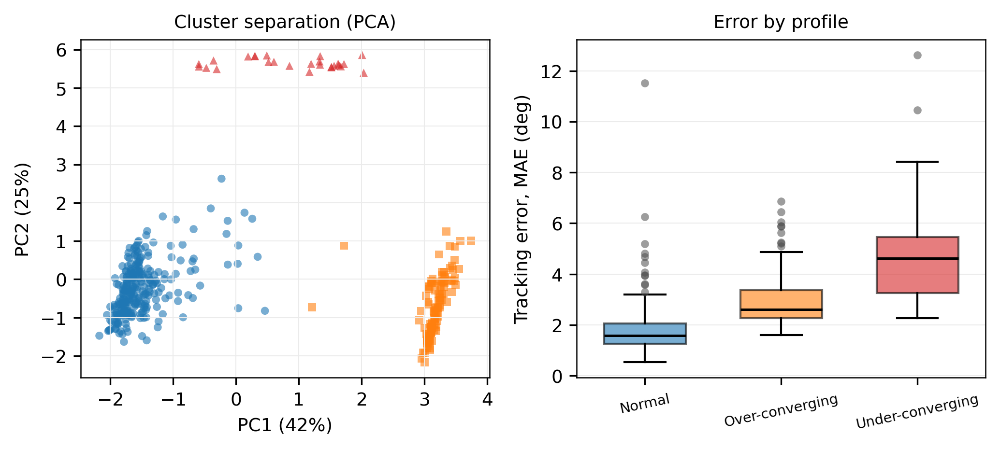

# VR Vergence-Based User Profiling

The experimentation code for the paper [**"VR Vergence-Based User Profiling: Clustering Binocular Coordination Patterns for Adaptive Display Design"**][paper].

## Overview

VR head-mounted displays decouple **vergence** from **accommodation**, and how
well a user tolerates the resulting conflict depends on their individual
**binocular coordination**. We treat each participant's vergence response to
repeated depth changes as a **control-theoretic step response**, extract
biomarkers from a single 60-second task, and cluster **407 GazeBaseVR
participants** into interpretable, software-only profiles for adaptive VR
rendering.

> _Data source: **GazeBaseVR** (Lohr et al., 2023; [Figshare][gazebasevr-data])_

## Repository Structure

```
.
├── src/
│   ├── pilot_biomarker_extraction.py   # 1. VRG step response → 6 biomarkers / participant
│   ├── pilot_clustering.py             # 2. 11-feature K=3 clustering (KMeans/GMM/Agg)
│   ├── pilot_cross_validation.py       # 3. cross-task validation on PUR & RAN
│   └── step6_session_stability.py      # 4. session-to-session reproducibility (S1 → S2)
├── figs/
│   └── fig_clusters.png                # K=3 cluster scatter (PCA) + MAE
└── requirements.txt
```

## Requirements

- **Python 3.10+**
- Core libraries: `numpy`, `pandas`, `scipy`, `scikit-learn`, `matplotlib`

```bash
python -m venv .venv
.venv/Scripts/activate
pip install -r requirements.txt
```

## Method

Vergence is the horizontal angular difference between the two eyes
(`θ_v = θ_L − θ_R`). After clinical-standard preprocessing (±50° / velocity
artifact removal, zero-phase 2nd-order Butterworth at 40 Hz, two-point
central-difference velocity), each of the 23 depth transitions is treated as a
**step input**, from which we extract **6 biomarkers**:

| Biomarker     | Definition                                                | Unit  |
| ------------- | --------------------------------------------------------- |:-----:|
| Latency       | First 2σ deviation of the raw vergence after a transition | ms    |
| Speed         | Mean rate from onset to 90% of the step                   | deg/s |
| Overshoot     | Peak excess beyond target / step size                     | %     |
| Settling time | Time to stay within ideal ±1° for 200 ms                  | ms    |
| SS error      | Mean absolute tracking error in steady state (≥ 1.5 s)    | deg   |
| Jitter        | Steady-state standard deviation                           | deg   |

**Clustering input = 11 features**: latency, speed, overshoot, settling time and
SS error split into convergence / divergence (= 10), plus a single jitter term.

## Results

### Three binocular-coordination profiles (K=3, silhouette = 0.522)

Signed steady-state error separates the clusters into clinically meaningful
profiles:

| Cluster | Profile          | N (%)     | SS error | MAE   | Jitter |
| ------- | ---------------- |:---------:|:--------:|:-----:|:------:|
| **C0**  | Normal           | 263 (65%) | +1.0°    | 1.77° | 0.50°  |
| **C1**  | Over-converging  | 118 (29%) | +3.0°    | 2.98° | 0.43°  |
| **C2**  | Under-converging | 26 (6%)   | −4.9°    | 5.00° | 0.62°  |

<p align="center">
  
</p>

The smallest cluster (C2, ~6%) is the least stable and is consistent with the
prevalence and characteristics of clinical convergence insufficiency.

> [!NOTE]
> This repository contains only the experimentation code. For the full
> methodology and detailed results, please refer to the [paper].

## License

Released under the [MIT License](LICENSE).

<!-- TODO: replace # with the published paper URL once available. -->

[paper]: #
[gazebasevr-data]: https://figshare.com/articles/dataset/GazeBaseVR_Data_Repository/21308391
